<div align="center">


# 📸 Flixer — Screenshots

### Every story starts somewhere.

**A visual tour of the Flixer self-hosted media experience.**

Browse the interface, explore the media library, discover content, listen to music, and see the tools for users and server administrators.

[](https://github.com/flixermedia/flixer) [](https://github.com/flixermedia/flixer-web) [](https://github.com/flixermedia)

**[🎬 Flixer](https://github.com/flixermedia/flixer) · [🌐 Flixer Web](https://github.com/flixermedia/flixer-web) · [📚 Documentation](https://github.com/flixermedia/flixer-docs) · [🧩 Organisation](https://github.com/flixermedia)**

</div>

---

## 👋 Welcome to Flixer

Flixer is a self-hosted media platform that brings movies, television, music, discovery, social features, and media server administration into one cohesive web experience. This gallery highlights the interface through actual screenshots of the application.

> [!NOTE]
> These screenshots capture one installation and point in development. Some features and layouts may change, and media artwork, sample accounts, statistics, and library contents are illustrative rather than bundled with Flixer.

## 🧭 Gallery navigation

- [🎬 The Viewing Experience](#the-viewing-experience)
- [🔐 Accounts & Personalisation](#accounts--personalisation)
- [🍿 Your Media Library](#your-media-library)
- [🎵 Music & Listening](#music--listening)
- [🔎 Discover & Search](#discover--search)
- [📥 Media Requests](#media-requests)
- [💬 Profiles & Messaging](#profiles--messaging)
- [🛠️ Server Administration](#server-administration)

## 🖼️ At a glance

| Experience | Screens |
| --- | ---: |
| 🎬 The Viewing Experience | 1 |
| 🔐 Accounts & Personalisation | 2 |
| 🍿 Your Media Library | 2 |
| 🎵 Music & Listening | 2 |
| 🔎 Discover & Search | 3 |
| 📥 Media Requests | 2 |
| 💬 Profiles & Messaging | 2 |
| 🛠️ Server Administration | 2 |

---

## 🎬 The Viewing Experience

The main viewing interface brings your media together in a dark, artwork-first layout.

### Home

A cinematic home page with a featured title, full-width backdrop, contextual actions, and quick access to the media library.

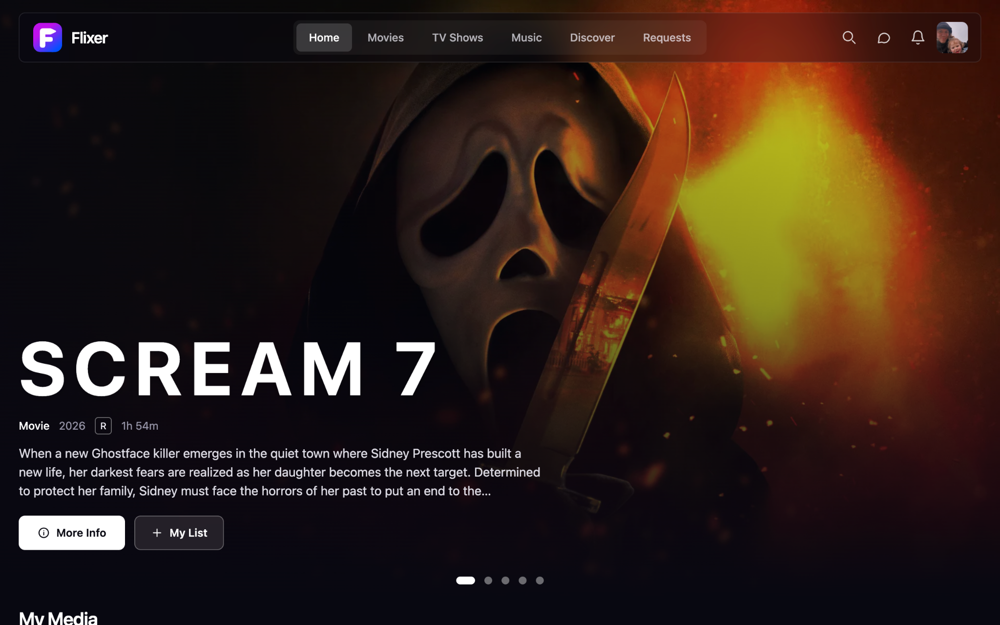

<sub>Screenshot: `images/home.png`</sub>

---

## 🔐 Accounts & Personalisation

Sign in securely and control how your account appears.

### Sign in

A split-layout welcome page with username and password fields, passkey sign-in, and a link to create an account.

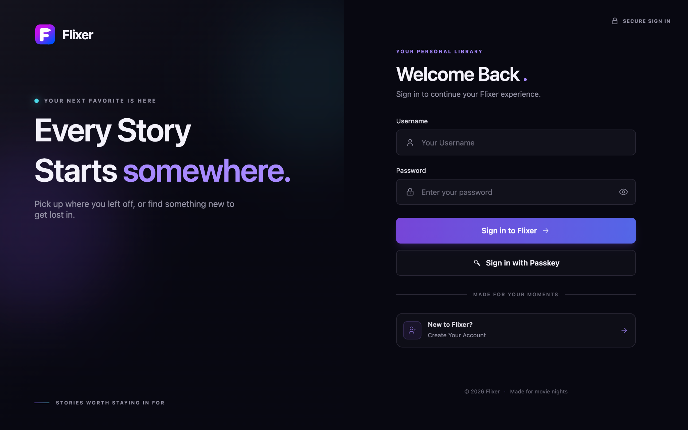

<sub>Screenshot: `images/sign-in.png`</sub>

---

### Account settings

Manage profile details, avatar, passkeys, language preferences, and password changes.

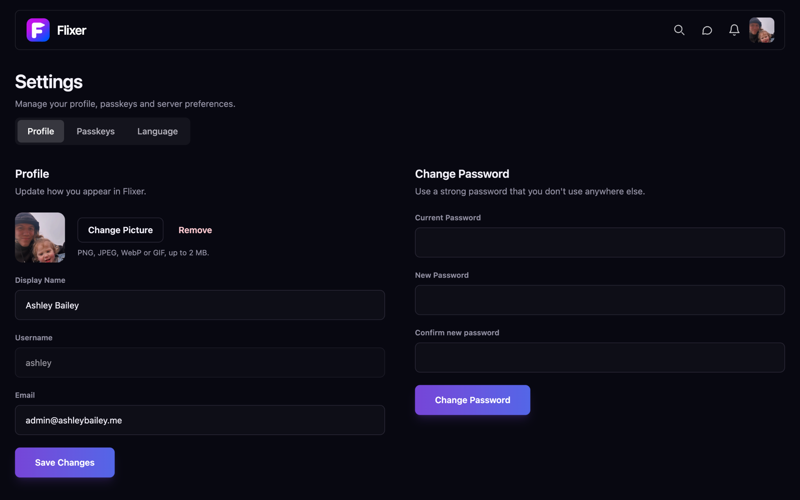

<sub>Screenshot: `images/account-settings.png`</sub>

---

## 🍿 Your Media Library

Browse local media and open detailed pages designed for playback.

### Movies library

Browse movies as a poster grid with titles, release years, and a sorting control.

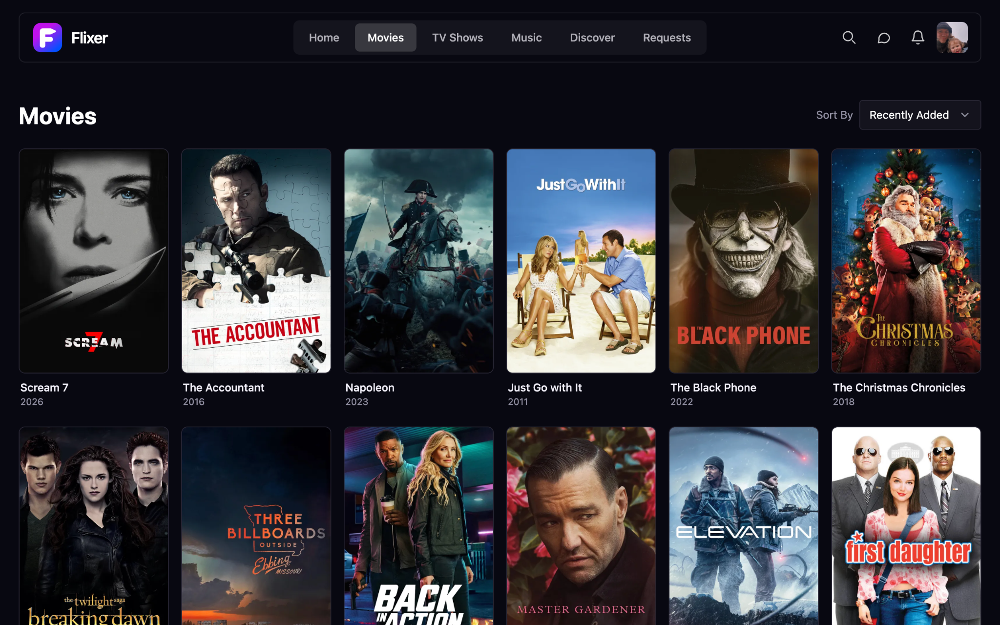

<sub>Screenshot: `images/movies-library.png`</sub>

---

### Movie details and chapters

A detailed movie page with artwork, metadata, technical media information, playback actions, watch-party controls, subtitles, and chapter thumbnails.

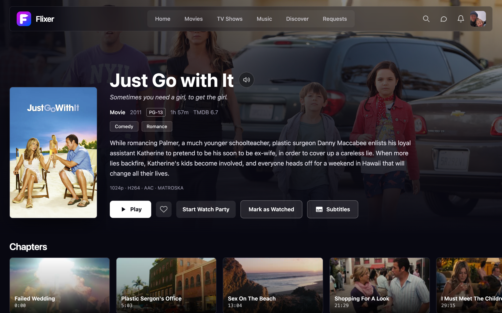

<sub>Screenshot: `images/movie-details.png`</sub>

---

## 🎵 Music & Listening

Browse albums, manage tracks, and follow lyrics while listening.

### Music album and tracks

An album detail view showing artwork, genres, description, playback and playlist actions, and a track list.

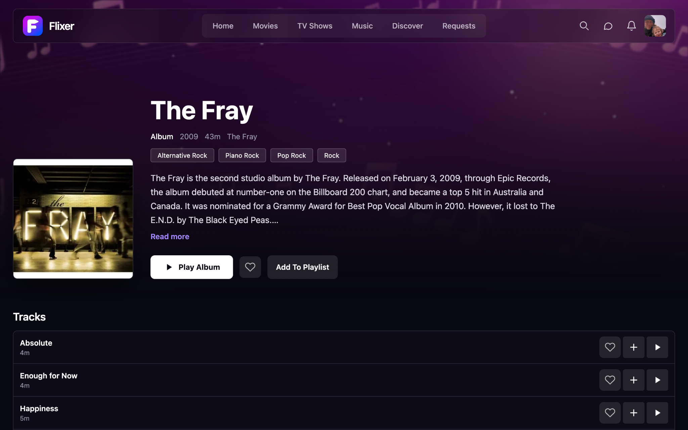

<sub>Screenshot: `images/music-album.png`</sub>

---

### Lyrics player

A full-screen listening experience with cover art, timed lyrics, a seek bar, and playback controls.

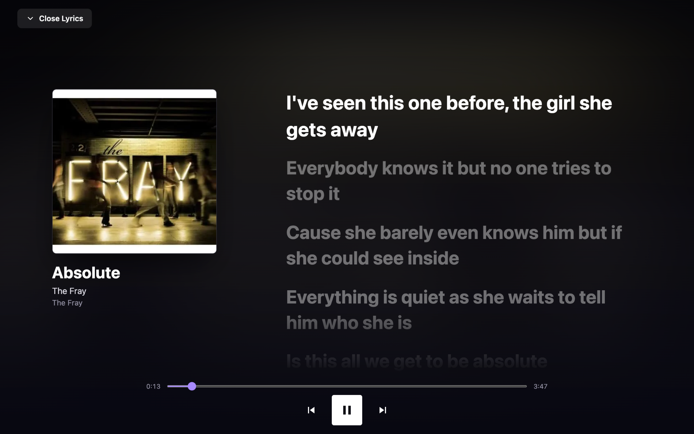

<sub>Screenshot: `images/music-lyrics-player.png`</sub>

---

## 🔎 Discover & Search

Find what is in your collection and explore media beyond it.

### Discover

Browse trending movies, TV series, and other recommendations with poster galleries and quick request actions.

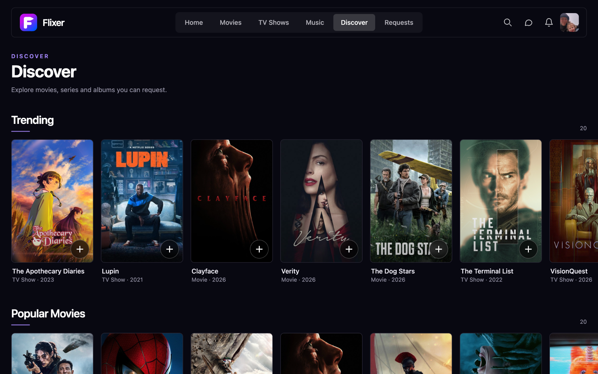

<sub>Screenshot: `images/discover.png`</sub>

---

### Search: music

Search across media types, filter by category, and find matching music already in a library alongside additional discovery results.

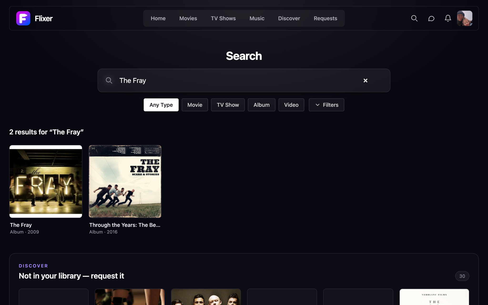

<sub>Screenshot: `images/search-music.png`</sub>

---

### Search: movies and requests

A search with no local matches that offers external discovery results and direct request buttons.

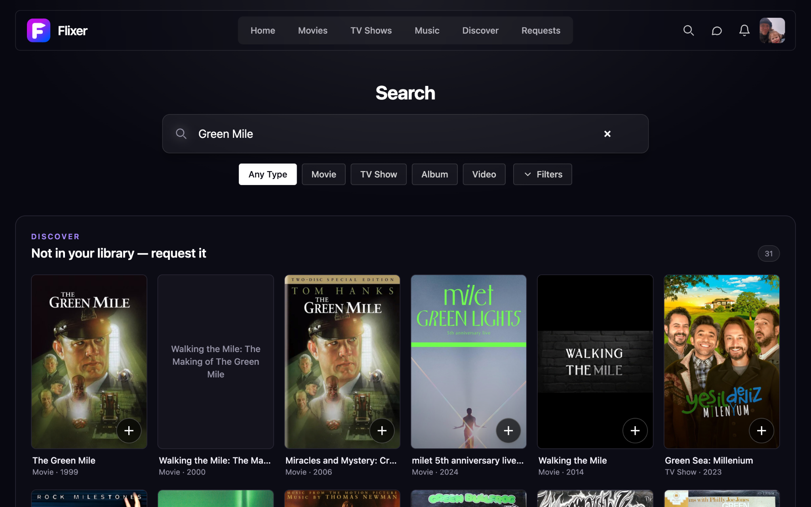

<sub>Screenshot: `images/search-movies.png`</sub>

---

## 📥 Media Requests

Request content and keep track of its status.

### Request details

A media discovery detail view with synopsis, cast, status, a request action, and advanced options for selecting a server or root folder.

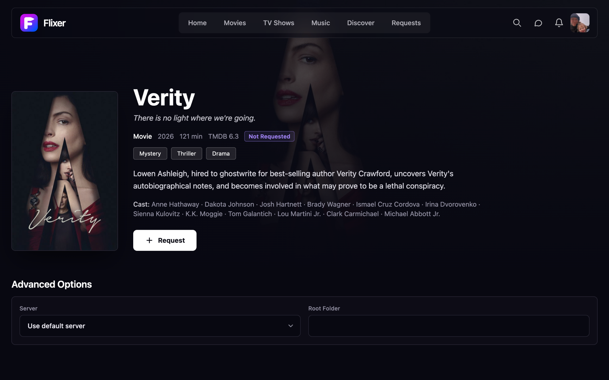

<sub>Screenshot: `images/request-details.png`</sub>

---

### Requests overview

Review submitted requests and filter by status or type, with approval and decline actions shown where available.

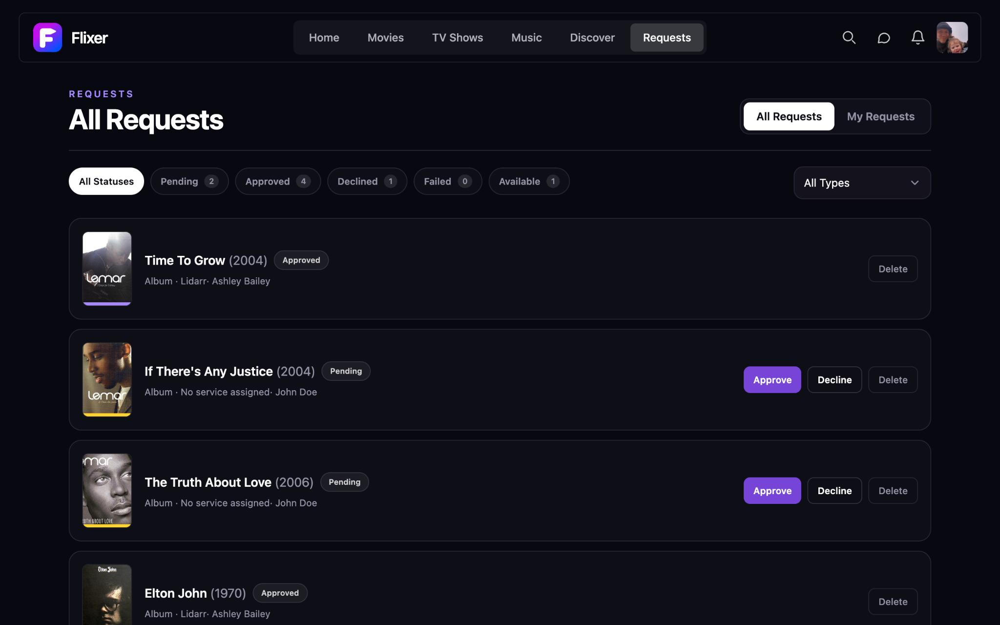

<sub>Screenshot: `images/requests-list.png`</sub>

---

## 💬 Profiles & Messaging

Keep connected with other members of your Flixer server.

### Public user profile

View a member profile, social actions, listening and watching statistics, and recently watched titles.

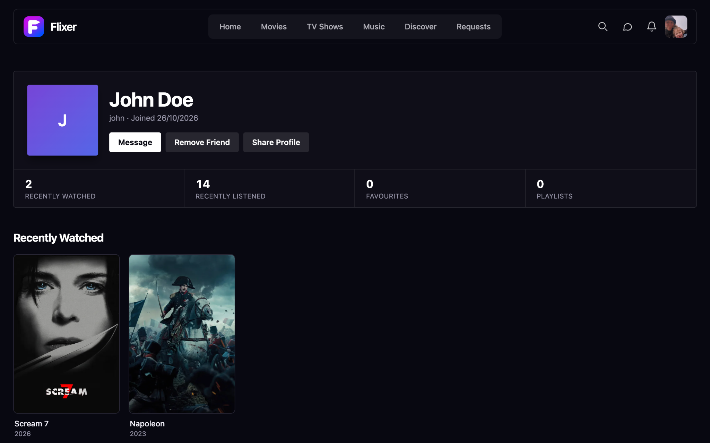

<sub>Screenshot: `images/user-profile.png`</sub>

---

### Direct messages

A two-panel private messaging layout with a conversation list, chat history, and message composer.

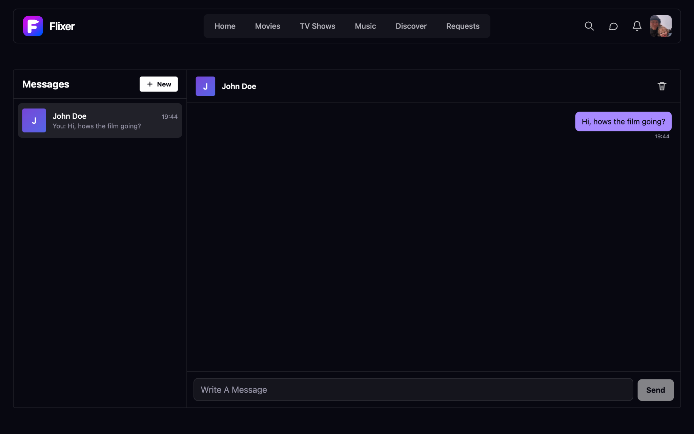

<sub>Screenshot: `images/messages.png`</sub>

---

## 🛠️ Server Administration

Manage and monitor the services and libraries behind your Flixer experience.

### Admin dashboard

Monitor server details, streamer and indexer status, storage usage, processing queues, updates, and library statistics.

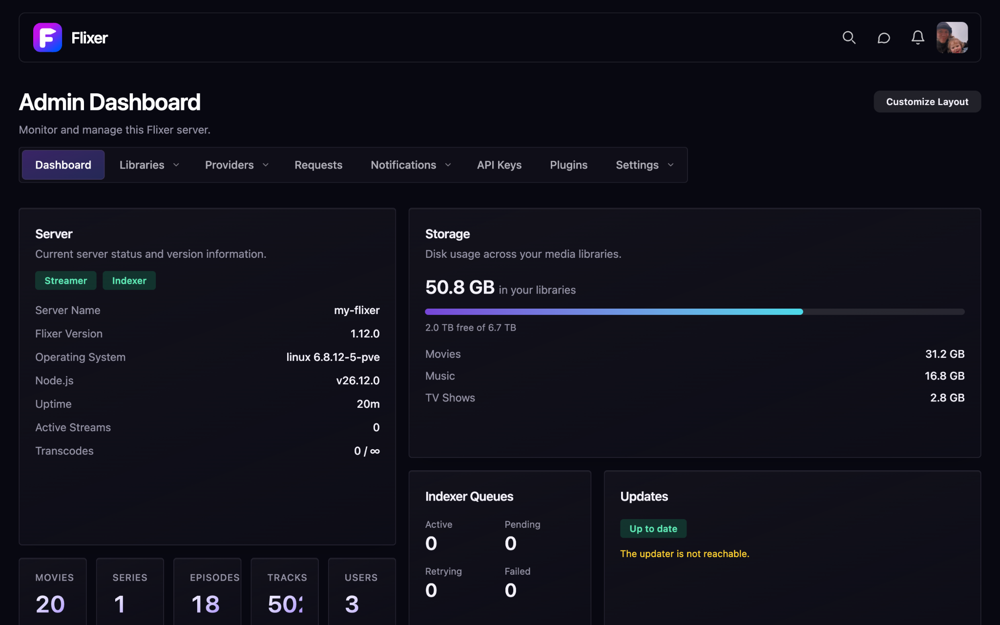

<sub>Screenshot: `images/admin-dashboard.png`</sub>

---

### Library administration

Manage network shares, connect SMB storage, add media libraries, and start scans or preview generation.

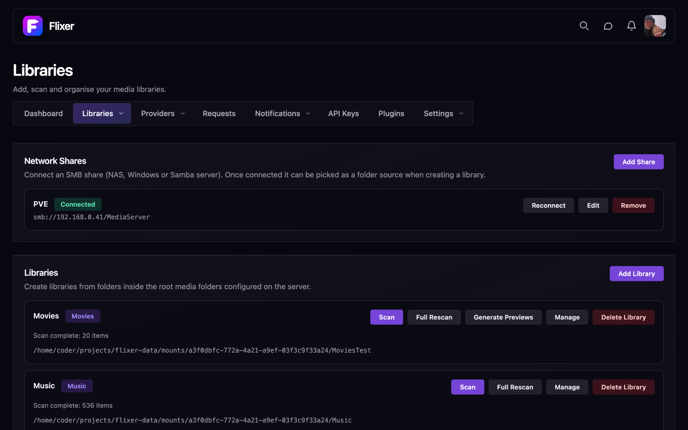

<sub>Screenshot: `images/admin-libraries.png`</sub>

---

## 🧱 About the interface

The Flixer web interface uses a dark visual foundation, prominent media artwork, compact navigation, and purple accent colours. The gallery shows several connected parts of the same experience:

- **Media-first browsing:** posters, featured backdrops, details, and library sorting.
- **Playback experiences:** movie playback actions, chapter navigation, album tracks, and an immersive lyrics view.
- **Discovery and requests:** search filters, trending titles, request states, and request management.
- **People and identity:** sign-in, passkeys, account settings, profiles, and direct messages.
- **Administration:** server health, queues, updates, network shares, and library scanning.

## 📁 Repository layout

```text
screenshots/
├── README.md
└── images/
    ├── home.png
    ├── sign-in.png
    ├── movies-library.png
    ├── movie-details.png
    ├── music-album.png
    ├── music-lyrics-player.png
    ├── discover.png
    ├── search-music.png
    ├── search-movies.png
    ├── request-details.png
    ├── requests-list.png
    ├── user-profile.png
    ├── messages.png
    ├── account-settings.png
    ├── admin-dashboard.png
    └── admin-libraries.png
```

All images use relative paths so they render directly on GitHub when `README.md` and the `images/` directory stay together.

## 🚀 Explore Flixer

| Repository | Purpose |
| --- | --- |
| [🎬 flixer](https://github.com/flixermedia/flixer) | Core application, APIs, users, and server orchestration. |
| [🌐 flixer-web](https://github.com/flixermedia/flixer-web) | Frontend implementation of the pages shown here. |
| [📺 flixer-streamer](https://github.com/flixermedia/flixer-streamer) | Streaming and transcoding service. |
| [🔍 flixer-indexer](https://github.com/flixermedia/flixer-indexer) | Media scanning and metadata processing. |
| [🔄 flixer-updater](https://github.com/flixermedia/flixer-updater) | Update management. |
| [🧩 flixer-plugins](https://github.com/flixermedia/flixer-plugins) | Official plugin collection. |
| [📚 flixer-docs](https://github.com/flixermedia/flixer-docs) | Documentation and guides. |

## 🤝 Contributing

Found a bug or have an idea for one of these views? Open an issue in [flixer-web](https://github.com/flixermedia/flixer-web/issues) for frontend issues, or use the appropriate component repository. For setup and development instructions, consult each repository’s README.

---

<div align="center">

**🎬 Flixer — Your media. Your server. Your rules.**

[Back to top](#-flixer--screenshots) · [GitHub organisation](https://github.com/flixermedia)

</div>
