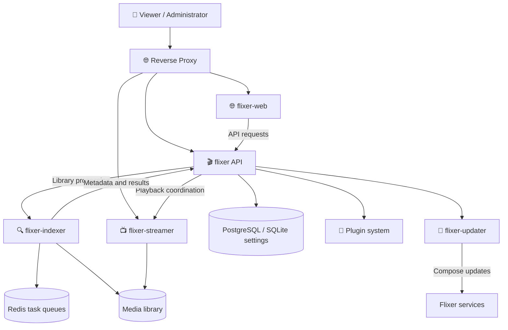

<div align="center">


# 🎬 Flixer

### Your media. Your server. Your rules.

**A modern, open-source, self-hosted media platform built around your library.**

Discover, organise, manage, and stream your movies and TV shows through a connected ecosystem of dedicated services.

[](https://github.com/flixermedia)
[](https://github.com/flixermedia/flixer)
[](https://github.com/flixermedia)
[](https://github.com/flixermedia/flixer)

**[🚀 Get Started](#-get-started)** · **[🧩 Explore Repositories](#-our-ecosystem)** · **[🏗️ Architecture](#%EF%B8%8F-how-flixer-fits-together)** · **[🤝 Contribute](#-contributing)**

</div>

---

## 👋 Welcome to Flixer

Flixer is a self-hosted media server for people who want to enjoy their own media without giving up control over where it lives or how it is managed.

A media server is more than a player. It needs to understand your files, organise your collection, deliver compatible streams, offer an intuitive interface, and keep all of its moving parts working together. **That's why Flixer is built as an ecosystem rather than a single, tightly coupled application.**

The backend, web experience, streaming engine, media indexer, update manager, plugin catalogue, and documentation live in separate repositories. Each component has a focused responsibility, while the overall system is designed to feel like one product.

> [!IMPORTANT]
> **Flixer is under active development.** Features, configuration, APIs, installation methods, and compatibility may change. Consult the individual repositories before deploying to a production or critical environment.

### ✨ What we're building

| | Focus | What it means |
| :---: | --- | --- |
| 🏠 | **Self-hosting** | Keep your media server under your own control. |
| 🎞️ | **A cinematic experience** | Browse and watch from a modern web interface. |
| 🔎 | **Media intelligence** | Identify library content and enrich it with metadata and artwork. |
| 📺 | **Flexible playback** | Separate streaming and transcoding responsibilities from the main API. |
| 🧱 | **Modularity** | Improve or extend individual components without turning the codebase into one monolith. |
| 🧩 | **Extensibility** | Build toward a permission-aware plugin ecosystem. |
| 🔐 | **Privacy-minded design** | Focus on self-hosting rather than requiring a hosted Flixer account. |
| 🛠️ | **Open development** | Build in public, discuss issues, and welcome contributions. |

---

## 📸 Take a Look at Flixer

Curious what Flixer looks like? Explore our screenshot gallery for a closer look at the interface, media libraries, music playback, discovery, user profiles, and server administration.

<p align="center">
  <a href="./GALLERY.md">
    
  </a>
</p>

**[View the Full Screenshot Gallery →](../GALLERY.md)**

---

## 🧩 Our ecosystem

**Seven repositories. One connected media platform.**

| Repository | Technology | Responsibility |
| --- | --- | --- |
| [🎬 **flixer**](https://github.com/flixermedia/flixer) | TypeScript | Core backend, APIs, users, settings, libraries, and orchestration. |
| [🌐 **flixer-web**](https://github.com/flixermedia/flixer-web) | Vue | Web frontend for browsing, administration, and playback. |
| [📺 **flixer-streamer**](https://github.com/flixermedia/flixer-streamer) | Go | Media delivery, direct streaming, and transcoding. |
| [🔍 **flixer-indexer**](https://github.com/flixermedia/flixer-indexer) | Go | Scanning, identification, metadata, artwork, probing, and trickplay generation. |
| [🔄 **flixer-updater**](https://github.com/flixermedia/flixer-updater) | Go | Update orchestration, backups before updates, health checks, and rollback. |
| [🧩 **flixer-plugins**](https://github.com/flixermedia/flixer-plugins) | Plugin manifests / packages | Official plugin catalogue, manifests, schemas, and example plugin. |
| [📚 **flixer-docs**](https://github.com/flixermedia/flixer-docs) | TypeScript / Docusaurus | Source for project documentation and guides. |

### 🎬 Flixer Core — The foundation

[**Explore flixer →**](https://github.com/flixermedia/flixer)

The core backend coordinates the services that make Flixer work. It provides the API and manages application-level concerns such as accounts, configuration, libraries, and integration with the supporting services.

- Central API and system orchestration
- User and administrator functionality
- Media-library configuration and management
- Database-backed application services
- Service integrations and shared configuration
- Docker Compose-based deployment

**Start here** if you're deploying Flixer or contributing to its server-side logic.

### 🌐 Flixer Web — The experience

[**Explore flixer-web →**](https://github.com/flixermedia/flixer-web)

The web application is the part of Flixer people interact with. It presents the library, handles everyday navigation, and provides the interface for managing and watching content.

- Modern, Vue-based frontend
- Browsing and navigating media collections
- Playback and player-related UI
- Administrative and configuration screens
- Integration with the Flixer backend

**Start here** if you work on frontend engineering, interface design, or usability.

### 📺 Flixer Streamer — The playback engine

[**Explore flixer-streamer →**](https://github.com/flixermedia/flixer-streamer)

A dedicated Go service responsible for delivering media streams. Keeping streaming in its own component allows playback concerns to evolve independently of the main application server.

- Streaming and media delivery
- Direct-play and transcoding workflows
- Integration with the backend and web player
- Dedicated media-processing responsibilities

**Start here** if you enjoy media protocols, video delivery, codecs, or performance engineering.

### 🔍 Flixer Indexer — The library brain

[**Explore flixer-indexer →**](https://github.com/flixermedia/flixer-indexer)

The Go indexer processes media-library content and returns enriched records to Flixer. It uses Redis-backed Asynq queues for separate processing stages, including scanning, identification, metadata, images, and media probing.

- Automated library scanning and file watching
- Identification of movies, episodes, and other media
- Metadata and artwork enrichment from supported sources
- Local NFO and artwork prioritisation
- FFmpeg / ffprobe media analysis
- Trickplay thumbnail generation for seek previews

**Start here** if you want to improve metadata matching, media recognition, or library automation.

### 🔄 Flixer Updater — Safer maintenance

[**Explore flixer-updater →**](https://github.com/flixermedia/flixer-updater)

The updater is a Go-based sidecar for handling updates initiated from Flixer's administration interface. Its update flow includes a database backup, component version selection, sequential restarts, health checks, and rollback when eligible.

- Docker Compose service update orchestration
- Backup before an update
- Per-service health verification
- Version tracking and update status
- Rollback to known previous versions when supported

**Start here** if you want to work on deployment automation and operational reliability.

### 🧩 Flixer Plugins — Extend the platform

[**Explore flixer-plugins →**](https://github.com/flixermedia/flixer-plugins)

This repository hosts the official plugin catalogue and its manifest schemas. It provides a versioned distribution model and demonstrates how plugins can extend the platform with declared permissions.

- Repository-level `repository.json` catalogue
- Versioned, integrity-checked plugin packages
- Plugin and repository manifest schemas
- Permission declarations and validation
- Working WASI example plugin with a backend route and persistent counters

**Current status:** The example plugin is implemented; other named plugins in the catalogue are planned migrations. Check the repository for what is installable today.

**Start here** if you want to develop extensions or help shape the plugin ecosystem.

### 📚 Flixer Docs — The knowledge base

[**Explore flixer-docs →**](https://github.com/flixermedia/flixer-docs)

The documentation repository is the home for maintaining guides and explanations about the project. Code and documentation should develop together, so users and contributors have a dependable place to understand how the platform works.

- Installation and configuration documentation
- System concepts and architecture
- Service-specific explanations
- Development and contribution guides
- Troubleshooting and operational guidance

**Start here** if you want to improve guides, examples, or technical writing.

---

## 🏗️ How Flixer fits together

Flixer separates its responsibilities into cooperating applications. The following is a **conceptual overview**, not a complete network, authentication, or container topology.



### From files to playback

1. **Configure a library.** Tell Flixer where your media lives.
2. **Scan and identify.** The indexer examines the files, identifies content, and enriches it with metadata and artwork.
3. **Browse.** The web frontend displays your organised collection through the backend API.
4. **Watch.** Flixer coordinates playback while the streamer delivers a suitable media stream.
5. **Maintain.** The updater assists with managed upgrades, while plugins provide an extension path.

### Why multiple services?

- **Focused codebases:** Each repository owns a specific problem area.
- **Technology fit:** TypeScript and Vue support application and interface development; Go supports the dedicated processing services.
- **Clearer maintenance:** Teams and contributors can work in one area without learning the entire system first.
- **Independent evolution:** Individual components have their own source, release history, and implementation details.

---

## 🚀 Get started

The main **[flixer](https://github.com/flixermedia/flixer)** repository is the entry point for installation. You generally do **not** need to clone and run every repository individually to use Flixer.

### Requirements

- A supported macOS or Debian/Ubuntu Linux system for the published installer
- Docker and Docker Compose v2 for a manual Compose deployment
- Storage for application data and your media library
- A modern browser to access the Flixer web interface

### Option 1 — Guided installation

The core repository currently documents the following installer:

```bash
curl -fsSL https://get.flixer.dev | bash
```

> [!TIP]
> Review the [installer source](https://github.com/flixermedia/flixer/blob/main/install.sh) before running a remote shell script. The installer can configure the deployment, ask for folders and a port, and start the Docker Compose stack.

After installation, open the address and port shown by the installer. The documented default for a local deployment is:

```text
http://localhost:8080
```

Complete the application's setup flow to configure the server and administrator account.

### Option 2 — Docker Compose

If you prefer a manual installation, the core repository includes its own `docker-compose.yml` and `.env.example`. Follow the current [manual installation instructions](https://github.com/flixermedia/flixer#manual-install), rather than using an unrelated Compose example.

The root data directory is configured with `DATA_DIR`; media mounts and additional settings depend on your deployment. Consult the core README for volume permissions, network shares, secrets, and upgrade considerations.

### Already using Flixer?

- [Core deployment and configuration](https://github.com/flixermedia/flixer#configuration-notes)
- [Repository releases](https://github.com/flixermedia/flixer/releases)
- [Report a bug](https://github.com/flixermedia/flixer/issues/new)
- [Check known issues](https://github.com/flixermedia/flixer/issues)

> [!WARNING]
> Protect your media and application data. Keep backups, check release notes, and avoid exposing internal service ports unnecessarily. The updater's Docker access is particularly sensitive; its own documentation explains the security implications.

---

## 🧑‍💻 For developers

Whether you specialise in frontend design, API architecture, media transcoding, system automation, or documentation, there's an area of Flixer to explore.

### Project technology

| Area | Main technologies and concepts |
| --- | --- |
| Backend | TypeScript, APIs, PostgreSQL, SQLite configuration |
| Frontend | Vue, modern web tooling |
| Streaming | Go, media delivery and transcoding |
| Indexing | Go, Redis / Asynq, FFmpeg / ffprobe, metadata providers |
| Deployment | Docker, Docker Compose, reverse proxy |
| Update management | Go, Docker Compose orchestration, PostgreSQL backups |
| Plugins | Manifests, versioned artifacts, permissions, WASI example |
| Documentation | TypeScript, Docusaurus |

### Run from source

For cross-service development, clone the main application and the relevant sibling repositories:

```bash
mkdir flixer-workspace
cd flixer-workspace

git clone https://github.com/flixermedia/flixer.git
git clone https://github.com/flixermedia/flixer-web.git
git clone https://github.com/flixermedia/flixer-streamer.git
git clone https://github.com/flixermedia/flixer-indexer.git
```

The main repository documents a development Compose file that builds these sibling projects:

```bash
cd flixer
# Configure DATA_DIR and any other required development settings first.
docker compose -f docker-compose.dev.yml up --build
```

For work on a single service, consult that repository's README, environment example, tests, and source layout. Service-specific dependencies and environment variables may differ from the full-stack deployment.

### Building responsibly

When contributing across repositories, consider more than the individual change:

- **Compatibility:** Will the change affect API calls, service messages, data schemas, or client behaviour?
- **Security:** Are authentication, permissions, secrets, and path access handled safely?
- **Reliability:** Does the change fail gracefully when another service is unavailable?
- **Observability:** Are errors and operational events understandable to an administrator?
- **Performance:** Could the change impact scanning, playback startup, disk use, or memory?
- **Documentation:** Can another contributor reproduce and understand the change?

---

## 🧩 Extending Flixer

The plugin system is intended to let functionality grow without requiring every integration to live inside the core application.

The official catalogue at [flixer-plugins](https://github.com/flixermedia/flixer-plugins) provides:

1. A repository manifest describing available plugin releases.
2. Per-plugin manifests that declare capabilities and permissions.
3. Versioned packages with SHA-256 integrity information.
4. A working example illustrating a WASI backend extension.

This is an evolving system. **Do not assume all proposed plugin types or planned integrations are already implemented.** Check the catalogue and individual manifests for the current supported capabilities and installation requirements.

Want to contribute an extension? Start by reviewing the [catalogue README](https://github.com/flixermedia/flixer-plugins) and [manifest schemas](https://github.com/flixermedia/flixer-plugins/tree/main/schemas).

---

## 🤝 Contributing

Flixer is developed in the open, and thoughtful contributions help make every part of the ecosystem better.

You can contribute by:

- 🐛 **Reporting bugs** with logs, reproduction steps, and expected behaviour.
- 💡 **Proposing improvements** to user experience, APIs, or service architecture.
- 🧹 **Improving code quality** with tests, refactors, and performance work.
- 🎨 **Polishing the interface** and accessibility of the web app.
- 🌍 **Improving documentation** and fixing inaccurate instructions.
- 🧩 **Exploring integrations** and the evolving plugin model.

### A good contribution workflow

1. Find the repository that owns the feature or bug.
2. Search its issues and pull requests for existing discussions.
3. Open an issue first for a substantial feature or architectural change.
4. Create a focused branch and make your changes.
5. Run the relevant tests, formatters, and checks documented in that repository.
6. Submit a pull request describing *what changed*, *why*, and *how to verify it*.

Please keep reports respectful and actionable. Avoid publishing credentials, private media, access tokens, or personal data in issue reports or logs.

**Useful starting points:** [All repositories](https://github.com/orgs/flixermedia/repositories) · [Core issues](https://github.com/flixermedia/flixer/issues) · [Core pull requests](https://github.com/flixermedia/flixer/pulls)

---

## 🗺️ Direction and priorities

The Flixer ecosystem is organised around a handful of enduring goals:

| Priority | Direction |
| --- | --- |
| 🎨 Experience | Make browsing, administration, and playback feel cohesive. |
| ⚡ Performance | Keep streaming and library processing responsive and efficient. |
| 📂 Libraries | Improve identification, metadata quality, artwork, and media organisation. |
| 🧩 Extensions | Evolve a robust, understandable, permission-aware plugin architecture. |
| 🛡️ Operations | Make installation, updates, recovery, and configuration safer. |
| 📚 Documentation | Give users and contributors clear, up-to-date information. |

This table describes **project direction, not a committed release schedule or a promise that every capability is available today**. Use the repositories' issues, commits, and release notes to assess current implementation and planned work.

---

## ❓ Frequently asked questions

<details>
<summary><strong>Is Flixer a hosted streaming service?</strong></summary>

No. Flixer is designed as self-hosted software for managing and playing media from libraries you configure. It is not a subscription catalogue of licensed movies or shows.

</details>

<details>
<summary><strong>Do I need every repository to install Flixer?</strong></summary>

No. Start with the main `flixer` repository and its documented installer or Docker Compose deployment. The component repositories are especially useful for development and deeper technical exploration.

</details>

<details>
<summary><strong>Why are the web, streamer, and indexer separate?</strong></summary>

They handle different responsibilities: user experience, playback delivery, and library processing. This separation makes the codebases easier to reason about and allows each area to evolve more independently.

</details>

<details>
<summary><strong>Can I use Flixer with media on a network share?</strong></summary>

The core installation guide documents SMB share options. Review the deployment instructions for the supported mount approach on your host operating system and the required access permissions.

</details>

<details>
<summary><strong>Is the plugin ecosystem ready for third-party developers?</strong></summary>

The official repository includes a catalogue format, schemas, and a working example. Support continues to evolve; verify the currently implemented capabilities and compatibility rules before building or distributing a plugin.

</details>

<details>
<summary><strong>Where should I report a problem?</strong></summary>

Use the issue tracker for the repository that owns the affected component. If you're unsure which component is responsible, the [main issue tracker](https://github.com/flixermedia/flixer/issues) is a reasonable place to start.

</details>

---

## 🔗 Quick links

| Looking for… | Go here |
| --- | --- |
| 🎬 Main project | [flixermedia/flixer](https://github.com/flixermedia/flixer) |
| 🚀 Installation | [Flixer installation guide](https://github.com/flixermedia/flixer#-install) |
| 📋 Feature inventory | [FEATURES.md](https://github.com/flixermedia/flixer/blob/main/FEATURES.md) |
| 🌐 Web interface | [flixer-web](https://github.com/flixermedia/flixer-web) |
| 📺 Playback engine | [flixer-streamer](https://github.com/flixermedia/flixer-streamer) |
| 🔍 Indexer | [flixer-indexer](https://github.com/flixermedia/flixer-indexer) |
| 🔄 Update manager | [flixer-updater](https://github.com/flixermedia/flixer-updater) |
| 🧩 Plugin catalogue | [flixer-plugins](https://github.com/flixermedia/flixer-plugins) |
| 📚 Documentation source | [flixer-docs](https://github.com/flixermedia/flixer-docs) |
| 🐛 Issues and feedback | [Core issues](https://github.com/flixermedia/flixer/issues) |
| 💻 All source code | [Organisation repositories](https://github.com/orgs/flixermedia/repositories) |

---

## ⚖️ Open source and responsible use

Flixer is built in public. For the licence and applicable conditions of each component, consult that repository's licence information; do not assume that every repository has identical terms.

Flixer supplies media-management and playback software. You are responsible for ensuring that the media you store, access, and play is used in accordance with applicable law and the rights of its owners.

---

<div align="center">

### ❤️ Built for people who want control over their media.

**Your media. Your server. Your rules.**

[Explore the code](https://github.com/orgs/flixermedia/repositories) · [Start with Flixer](https://github.com/flixermedia/flixer) · [Contribute](https://github.com/flixermedia/flixer/issues)

<sub>© Flixer contributors. See individual repositories for licensing information.</sub>

</div>
